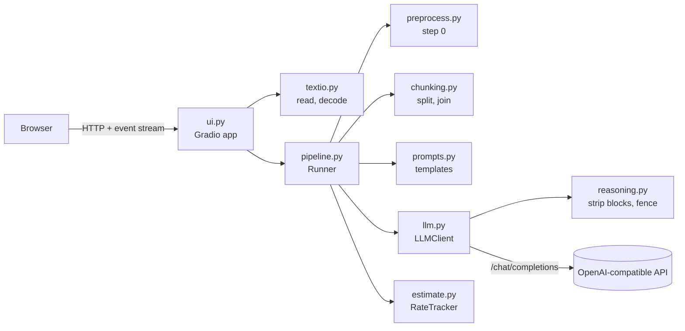

# Architecture

## Overview

One process serves the interface and runs the jobs. A job is an async
generator inside the request of the browser that started it.

## Modules

| Module | Responsibility |
|---|---|
| `config.py` | Reads and validates all settings from the environment into an immutable `Settings` object. |
| `textio.py` | Checks extension and size, decodes bytes, rejects binary data. |
| `preprocess.py` | Step 0: SRT/WebVTT/timestamp parsing, cue joining, speaker labels. |
| `chunking.py` | Splits text into `Segment(lead, core, trail)` without loss; joins processed segments; halves a segment. |
| `steps.py` | Step order, presets, and the mapping of selected steps to passes. |
| `prompts.py` | Loads prompt files (shipped or overridden) and fills placeholders in one pass. |
| `llm.py` | Sends one prompt, classifies errors, retries transient ones. |
| `reasoning.py` | Removes reasoning blocks and an enclosing code fence from model output. |
| `language.py` | Identifies the language of a text from frequent function words, for the language warning. |
| `pipeline.py` | Runs a job: preprocessing, passes, failure handling, progress events, metadata header. |
| `estimate.py` | Measures seconds per 1,000 characters and estimates durations. |
| `i18n.py` | Interface texts in English and German; choice of the interface language. |
| `ui.py` | Gradio layout and event handlers; temporary files of a job. |
| `__main__.py` | Command line: `--check`, `--version`, start. |

## Flow of a job

1. **Read the input.** `ui.py` reads the upload with `textio.py` and deletes
   it.
2. **Check the estimate.** `pipeline.estimate_job` computes the estimate; jobs
   above the limit are refused.
3. **Run the passes.** `Runner.run` yields events:
   1. step 0, if selected or forced by subtitle input;
   2. `split_text` into segments of at most `CHUNK_CHARS` characters;
   3. for each pass, every segment goes through `LLMClient.complete`, in
      parallel up to `PARALLEL_REQUESTS`, or one after another for the
      structure pass with consistent headings;
   4. `join_segments` after each pass.
4. **Hand over the result.** `ui.py` turns the events into progress updates.
   It writes the download files into a per-job directory, hands them to
   Gradio, and removes the directory.

## Segments

`split_text` returns segments whose `core` is sent to the model. The
whitespace around it (`lead`, `trail`) is kept aside and put back on joining.
The splitting has two properties, both covered by tests:

- **Lossless.** Joining the unprocessed segments gives back the input exactly.
- **No word is cut** as long as there is whitespace within the limit.

After a pass that can add Markdown blocks (structure, RAG), every seam
becomes a paragraph break, so that a heading at the start of a segment does
not stick to the previous sentence.

## Concurrency

| Level | Limit | Where |
|---|---|---|
| Jobs running at once | `MAX_CONCURRENT_JOBS` | Gradio `concurrency_limit` of the start event |
| Jobs waiting | `QUEUE_SIZE` | Gradio queue `max_size` |
| Requests per job | `PARALLEL_REQUESTS` | `asyncio.Semaphore` in `Runner` |

At most `MAX_CONCURRENT_JOBS × PARALLEL_REQUESTS` requests reach the API at
the same time.

## Failure handling

| Error | Reaction |
|---|---|
| timeout, connection error, HTTP 429/5xx, malformed or empty answer | retried up to `MAX_ATTEMPTS`, waiting 5 s and 15 s (or `Retry-After`) |
| `finish_reason: length`, unclosed reasoning block, HTTP 400/413/422 mentioning the context length | segment halved, halves halved once more if needed |
| other HTTP 4xx | segment keeps the text of the previous pass; a note is recorded |
| short first or last paragraph unrelated to the input, `#` heading in the structure pass | output kept; a note is recorded |
| HTTP 401, 403, 404 | job stops |
| every segment of a pass failed | job stops |

Error messages are not written into the result text.

## Data lifetime

| Data | Where | How long |
|---|---|---|
| upload | Gradio temporary directory | until read; deleted by the tool |
| decoded text, segments, intermediate results | process memory | until the job ends |
| download files | per-job directory, then Gradio's cache | the per-job directory until the job ends; the cache copy for `DOWNLOAD_RETENTION_MINUTES` |
| measured speed | process memory | until restart |

## Limits

- **One process, in memory.** There is no persistent state, so jobs do not
  survive a restart and cannot be shared between several processes. Several
  instances behind a load balancer each measure their own speed.
- **The browser keeps the connection open for the whole job.** Proxies must
  allow requests of that length.
- **Gradio couples the interface and the job.** The tool offers no separate
  programmatic interface; all Gradio events are marked private.
